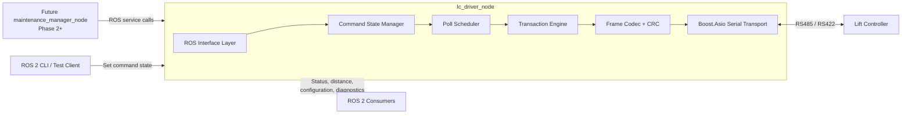
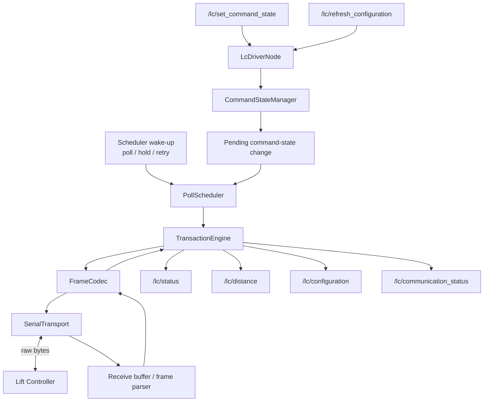
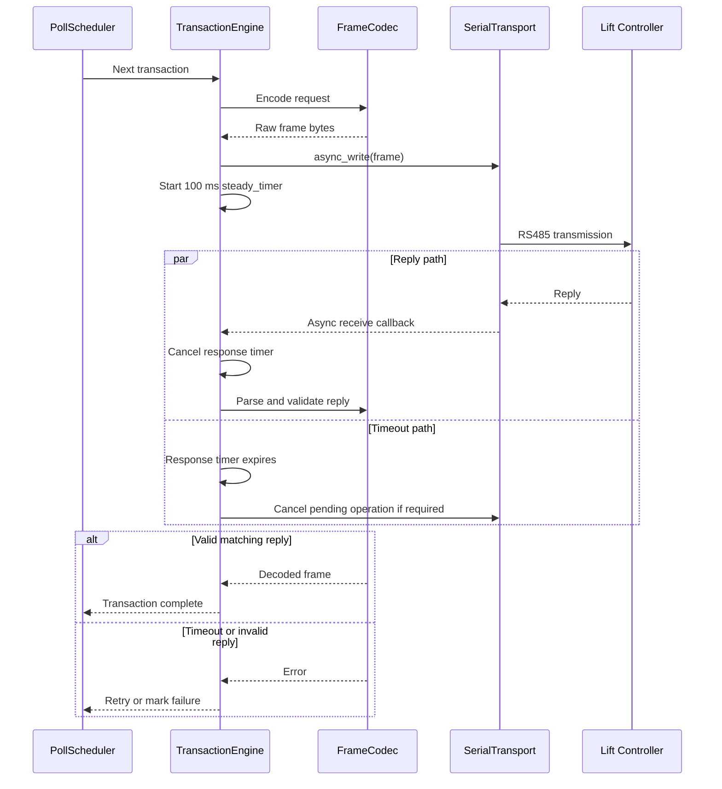
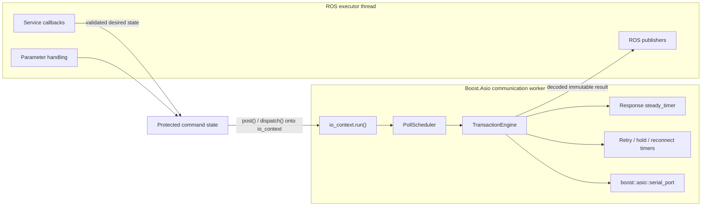
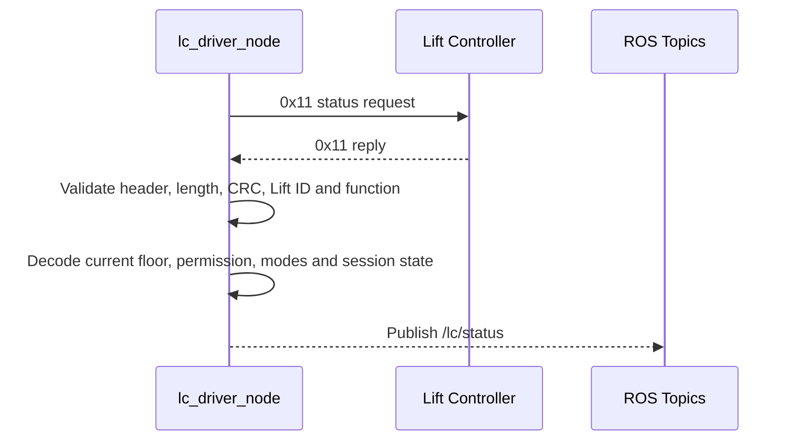
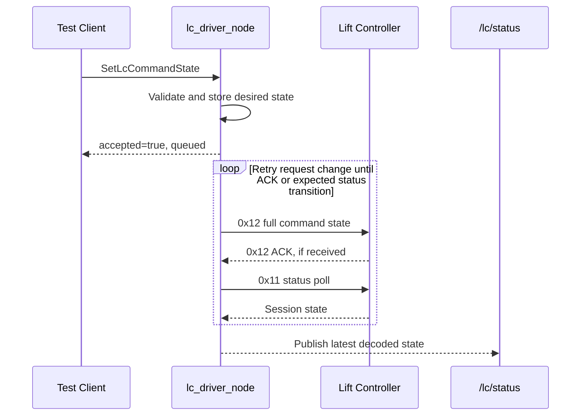
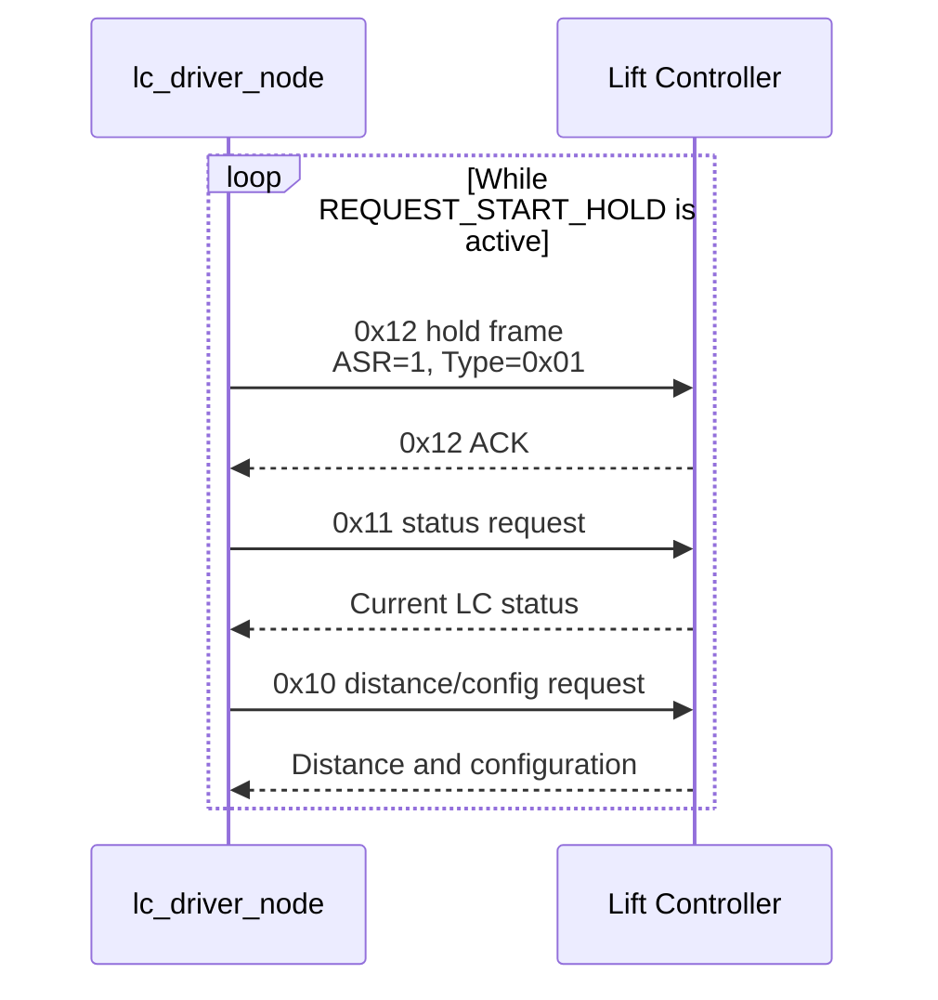
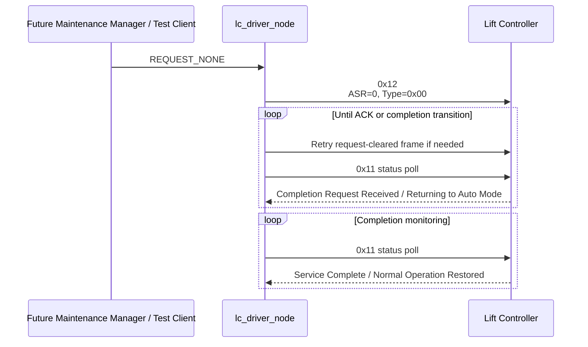
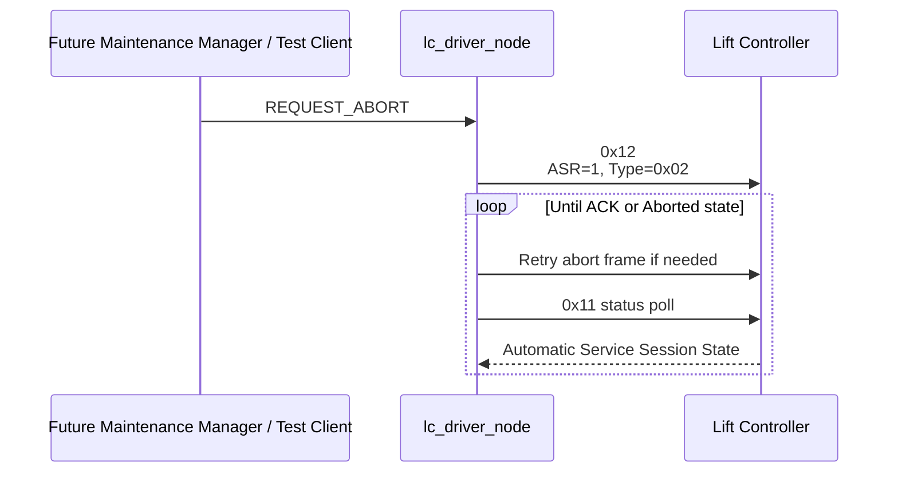

# Jetson–Lift Controller Communication Architecture

## 1. Purpose

This document defines the Phase 1 software architecture for communication between the Jetson and the Lift Controller (LC).

It is intended for:

- developers implementing the Jetson-side communication module;
- Codex or other coding agents working in the repository;
- future maintainers who need to understand the design boundaries;
- integration testing with ENV's LC software.

Phase 1 focuses only on reliable Jetson–LC communication. It does **not** implement the full nightly maintenance workflow, robot motion, or camera-based positioning.

### 1.1 Source documents

The repository shall keep the approved protocol and workflow documents under `docs/`. These documents are the primary behavioural requirements for this architecture and its implementation:

- `docs/Jetson LC Communication Protocol V6 - 290726.pdf`
- `docs/Maintenance Workflow V5 - 290726.pdf`

If the filenames change, update the paths in this section. Codex and future developers shall review these documents together with this architecture before changing protocol fields, command semantics, retry behaviour, session states, or abnormal handling.

Where this architecture conflicts with an approved protocol or workflow revision, the approved document takes precedence and `architecture.md` must be updated in the same change.

---

## 2. Phase 1 Scope

Phase 1 shall provide a reusable C++ ROS 2 driver that can:

- open and manage the RS485/RS422 serial connection;
- encode and transmit `0x10`, `0x11`, and `0x12` frames;
- receive, validate, and decode LC replies;
- calculate and verify CRC-16/MODBUS;
- poll the LC sequentially with one outstanding transaction at a time;
- publish decoded LC configuration, distance, status, and communication health;
- accept validated command-state changes through a ROS service;
- send periodic Robot Maintenance hold frames while the request is active;
- retry request changes until acknowledgement or the expected `0x11` transition is observed;
- keep all reserved door command bits OFF;
- support mock-LC and non-hardware integration testing.

Phase 1 shall **not**:

- start or schedule the nightly maintenance workflow;
- command the robot arm;
- interpret camera results;
- choose service floors;
- decide when maintenance should start, complete, or abort;
- implement the full maintenance workflow state machine.

Those responsibilities belong to a future `maintenance_manager_node`.

---

## 3. Protocol Summary

### 3.1 Serial communication

Current protocol assumptions:

- physical link: RS485/RS422;
- baud rate: `38400`;
- data format: `8N1`;
- Jetson is the initiator;
- LC is the responder;
- Jetson polls the LC sequentially;
- LC reply target: within `100 ms`.

### 3.2 Frame format

```text
Header | Data Length | Lift ID | Function Code | Data Portion | CRC
A5 A5  | 1 byte      | 1 byte  | 1 byte        | N bytes      | 2 bytes
```

`Data Length` counts bytes from `Lift ID` through the end of the `Data Portion`. It excludes the header and CRC.

All two-byte numerical values are high-byte first.

### 3.3 Function codes

| Function | Direction | Purpose |
|---|---|---|
| `0x10` | Jetson → LC | Request lift configuration and Distance from Car Top to Current Floor Sill |
| `0x10` | LC → Jetson | Return a 32-byte data portion |
| `0x11` | Jetson → LC | Request current operational and Robot Maintenance session status |
| `0x11` | LC → Jetson | Return a 4-byte data portion |
| `0x12` | Jetson → LC | Send the full 3-byte command state |
| `0x12` | LC → Jetson | Acknowledge that the command frame was received and accepted |

A `0x12` acknowledgement does not mean that a requested operation is complete. Actual progress is observed through `0x11`.

### 3.4 CRC

Current implementation assumption:

- algorithm: CRC-16/MODBUS;
- initial value: `0xFFFF`;
- reflected polynomial: `0xA001`;
- final XOR: `0x0000`;
- transmitted order: low byte first, then high byte;
- CRC input: bytes after the `A5 A5` header, from `Data Length` through the end of the `Data Portion`;
- the CRC bytes themselves are excluded.

Example:

```text
Full frame:
A5 A5 | 03 01 11 00 | CRC_LOW CRC_HIGH

CRC input:
03 01 11 00
```

ENV described the CRC range as "after header", but this has not yet been verified with a known-good sample frame. The CRC implementation and coverage range must therefore remain isolated inside the protocol library so they can be changed without affecting the driver architecture.

---

## 4. High-Level System Architecture



The architecture boundary is:

```text
lc_driver_node
    understands serial communication and the LC protocol

maintenance_manager_node
    understands the maintenance workflow and coordinates LC, robot, and vision
```

The LC driver shall never directly command the robot.

### 4.1 Architecture decision: use Boost.Asio

Phase 1 shall use **Boost.Asio** for serial I/O and timer-driven communication.

The selected runtime building blocks are:

- `boost::asio::io_context` for the communication event loop;
- `boost::asio::serial_port` for asynchronous serial reads and writes;
- `boost::asio::steady_timer` for the `100 ms` response deadline, request retries, hold-frame timing, and reconnect timing;
- one dedicated communication worker thread running `io_context.run()`.

Boost.Asio is preferred over direct POSIX `termios` read/write handling because this driver requires more than basic serial-port configuration:

- asynchronous reads and writes without blocking ROS callbacks;
- an exact response deadline per transaction;
- cancellation of pending operations when a timeout, shutdown, or disconnect occurs;
- scheduled retries and periodic hold frames;
- reconnect handling in the same event loop;
- clear ownership of all communication work on one worker thread;
- less handwritten `poll()`, `select()`, file-descriptor, and timeout state-machine code;
- a more maintainable design for Codex and future developers.

Direct `termios`-based `read()` and `write()` shall **not** be used as the primary transport implementation.

Linux-specific serial or RS485 configuration may still require `ioctl()` or access to `serial_port.native_handle()`. This is allowed only inside `SerialTransport`, for example if manual RS485 direction control or `TIOCSRS485` is required by the selected hardware. Such Linux-specific handling must not leak into the protocol, scheduler, transaction, or ROS interface layers.

---

## 5. Repository Structure

Recommended ROS 2 workspace layout:

```text
src/
├── jetson_lc_interfaces/
├── jetson_lc_protocol/
├── jetson_lc_driver/
└── jetson_lc_tools/
```

### 5.1 `jetson_lc_interfaces`

Contains ROS messages and services shared by the driver and future workflow nodes.

```text
jetson_lc_interfaces/
├── msg/
│   ├── LcStatus.msg
│   ├── LcConfiguration.msg
│   ├── LcDistance.msg
│   └── LcCommunicationStatus.msg
└── srv/
    ├── SetLcCommandState.srv
    └── RefreshLcConfiguration.srv
```

### 5.2 `jetson_lc_protocol`

A pure C++ protocol library with no ROS dependencies.

```text
jetson_lc_protocol/
├── include/jetson_lc_protocol/
│   ├── crc16_modbus.hpp
│   ├── frame.hpp
│   ├── frame_codec.hpp
│   ├── protocol_types.hpp
│   ├── configuration_codec.hpp
│   ├── status_codec.hpp
│   └── command_codec.hpp
├── src/
│   ├── crc16_modbus.cpp
│   ├── frame_codec.cpp
│   ├── configuration_codec.cpp
│   ├── status_codec.cpp
│   └── command_codec.cpp
└── test/
```

Responsibilities:

- encode and decode frames;
- generate and validate CRC;
- resynchronise on the `A5 A5` header;
- validate `Data Length`;
- validate expected Lift ID and Function Code;
- decode high-byte-first fields;
- decode `0x10` and `0x11` replies;
- encode `0x12` command data;
- reject invalid command-state combinations.

### 5.3 `jetson_lc_driver`

Contains the ROS 2 hardware-facing node and serial runtime.

```text
jetson_lc_driver/
├── include/jetson_lc_driver/
│   ├── lc_driver_node.hpp
│   ├── serial_transport.hpp
│   ├── transaction_engine.hpp
│   ├── poll_scheduler.hpp
│   └── command_state_manager.hpp
├── src/
│   ├── lc_driver_node.cpp
│   ├── serial_transport.cpp
│   ├── transaction_engine.cpp
│   ├── poll_scheduler.cpp
│   ├── command_state_manager.cpp
│   └── main.cpp
├── config/
│   └── lc_driver.yaml
├── launch/
│   └── lc_driver.launch.py
└── test/
```

For Phase 1, `lc_driver_node` should be a normal `rclcpp::Node`. The implementation should keep resource ownership and start/stop logic clean enough for a future lifecycle-node conversion.

The driver package shall depend on Boost.Asio and Boost.System. Its CMake configuration should resolve Boost explicitly, for example:

```cmake
find_package(Boost REQUIRED COMPONENTS system)
target_link_libraries(lc_driver_node PRIVATE Boost::system)
```

The final target names may differ, but Boost usage must be declared explicitly in `CMakeLists.txt` and `package.xml`.

### 5.4 `jetson_lc_tools`

Contains development and integration utilities.

```text
jetson_lc_tools/
├── src/
│   ├── mock_lc.cpp
│   ├── lc_command_cli.cpp
│   └── frame_inspector.cpp
└── config/
    └── mock_lc.yaml
```

---

## 6. `lc_driver_node` Internal Architecture



---

## 7. Core Components

### 7.1 `SerialTransport`

`SerialTransport` is the only class allowed to access the serial device.

Phase 1 shall implement this class using Boost.Asio.

Core Boost.Asio objects:

```cpp
boost::asio::io_context
boost::asio::serial_port
boost::asio::steady_timer
```

Responsibilities:

- open and close the serial port;
- configure `38400`, `8N1`, and no flow control;
- start and maintain the asynchronous receive loop;
- perform asynchronous frame writes;
- report partial reads to the receive-buffer/parser layer;
- cancel pending operations during timeout, disconnect, or shutdown;
- detect transport errors and notify the reconnect logic;
- expose the native handle only for isolated Linux-specific RS485 configuration;
- never decode function codes, CRC fields, or ROS messages.

Suggested interface:

```cpp
class SerialTransport
{
public:
    using ReadHandler = std::function<void(
        const boost::system::error_code&,
        std::vector<std::uint8_t>)>;

    using WriteHandler = std::function<void(
        const boost::system::error_code&,
        std::size_t)>;

    explicit SerialTransport(boost::asio::io_context& io_context);

    void open(const std::string& device, unsigned int baud_rate);
    void close();
    void cancel();

    bool is_open() const noexcept;

    void start_read(ReadHandler handler);

    void async_write(
        std::vector<std::uint8_t> bytes,
        WriteHandler handler);
};
```

The exact callback signatures may be refined during implementation, but these boundaries shall remain:

- `SerialTransport` owns the `boost::asio::serial_port`;
- the communication worker thread runs `io_context.run()`;
- serial completion handlers execute on that communication context;
- ROS callbacks never call blocking serial reads or writes;
- received byte chunks are passed to the protocol receive buffer;
- only one frame write may be active at a time;
- shutdown cancels operations before closing the port.

#### Why not direct `termios` I/O?

A direct `termios` implementation would require the project to manually build and maintain:

- `poll()` or `select()` loops;
- deadline calculations;
- cancellation behaviour;
- reconnect timers;
- partial-read wake-up handling;
- shutdown coordination;
- file-descriptor error-state handling.

Boost.Asio already provides a coherent event loop for these behaviours and fits the one-worker-thread transaction architecture. This reduces custom concurrency code and makes timing behaviour easier to test.

`termios` or Linux `ioctl()` may still be used indirectly through `serial_port.native_handle()` when a hardware-specific RS485 feature cannot be configured through the portable Boost.Asio serial options.

### 7.2 `FrameCodec`

The codec converts between raw bytes and protocol frames.

```cpp
struct Frame
{
    std::uint8_t lift_id;
    std::uint8_t function_code;
    std::vector<std::uint8_t> data;
};
```

The encoder produces:

```text
A5 A5
Data Length
Lift ID
Function Code
Data Portion
CRC Low
CRC High
```

The decoder shall reject:

- invalid header;
- invalid Data Length;
- incomplete frames;
- invalid CRC;
- wrong Lift ID;
- unexpected Function Code;
- incorrect data-portion size.

The receive parser must handle:

- partial frames;
- multiple frames in one read;
- noise before the header;
- malformed frames;
- recovery and resynchronisation after invalid data.

### 7.3 `CommandStateManager`

Every `0x12` frame sends the full three-byte command portion. The driver must therefore maintain one canonical desired command state.

```cpp
enum class ManualMotion : std::uint8_t
{
    Stop = 0,
    Up = 1,
    Down = 2
};

enum class RobotMaintenanceRequest : std::uint8_t
{
    None = 0x00,
    StartHold = 0x01,
    Abort = 0x02
};

struct DesiredCommandState
{
    std::uint8_t destination_floor{0};
    bool hall_call_disable{false};
    ManualMotion manual_motion{ManualMotion::Stop};
    RobotMaintenanceRequest maintenance_request{
        RobotMaintenanceRequest::None};
};
```

Mapping:

| Desired request | ASR bit | Request type |
|---|---:|---:|
| None / complete | `0` | `0x00` |
| Start or hold | `1` | `0x01` |
| Abort | `1` | `0x02` |

Validation rules:

- Manual Up and Manual Down cannot both be ON.
- Reserved door command bits must always be OFF.
- `ASR = 0` requires Type `0x00`.
- Start/Hold requires `ASR = 1`, Type `0x01`.
- Abort requires `ASR = 1`, Type `0x02`.
- Reserved door command fields shall not be exposed through the ROS service.
- A service response only means that the desired state was validated and queued.

### 7.4 `PollScheduler`

The scheduler chooses the next transaction while guaranteeing only one outstanding request.

Priority order:

1. Manual Down OFF / Manual Up OFF;
2. Abort request;
3. End Robot Maintenance request;
4. other changed `0x12` command state;
5. periodic `0x12` Start/Hold frame;
6. `0x11` status poll;
7. `0x10` configuration/distance poll.

Normal scheduling example:

```text
0x11 status
0x10 distance/configuration
0x11 status
0x12 hold, if active
0x11 status
...
```

All intervals except the LC response timeout must be configurable.

### 7.5 `TransactionEngine`

The transaction engine performs one request/reply exchange at a time.



A transaction contains:

```cpp
struct Transaction
{
    Frame request;
    std::uint8_t expected_function_code;
    std::chrono::milliseconds response_timeout;
    RetryPolicy retry_policy;
    TransactionPriority priority;
};
```

No ROS callback may directly write to the serial port.

---

## 8. Threading and Ownership

Use one ROS executor thread and one Boost.Asio communication worker thread.



Rules:

- the communication worker is the only thread that accesses `boost::asio::serial_port`;
- all serial reads, writes, response deadlines, retries, hold frames, and reconnect events run through the same `io_context`;
- only one serial transaction may be outstanding;
- service callbacks must not block for the LC's `100 ms` response;
- ROS callbacks update protected desired state and post work onto the `io_context`;
- do not use blocking `read()`, blocking `write()`, `sleep_for()`-based protocol timing, or detached threads;
- use RAII for serial-port and timer ownership;
- cancel outstanding Asio operations before closing the port;
- stop the `io_context`, stop and join the worker thread, and then destroy communication objects during node shutdown.

---

## 9. ROS Interfaces

### 9.1 `/lc/status`

Published after each valid `0x11` reply.

Suggested `LcStatus.msg`:

```text
builtin_interfaces/Time stamp

uint8 lift_id
uint8 current_floor

bool arrived_at_destination
bool jetson_operation_permitted
bool robot_maintenance_mode
bool lift_abnormal_mode

uint8 automatic_service_session_state
uint8 automatic_service_abnormal_reason
```

### 9.2 `/lc/distance`

Published after each valid `0x10` reply.

Suggested `LcDistance.msg`:

```text
builtin_interfaces/Time stamp

uint16 distance_from_car_top_to_current_floor_sill_mm
bool valid
```

### 9.3 `/lc/configuration`

Published after startup and whenever configuration changes.

Suggested `LcConfiguration.msg`:

```text
builtin_interfaces/Time stamp

uint16 rated_capacity_kg
uint16 car_width_mm
uint16 door_width_mm

bool has_second_door
uint8 second_door_position

uint8[] service_floor_configuration
```

Use transient-local durability so future nodes can obtain the most recent configuration immediately after subscribing.

### 9.4 `/lc/communication_status`

Suggested `LcCommunicationStatus.msg`:

```text
builtin_interfaces/Time stamp

bool serial_connected
bool receiving_valid_frames
bool status_stale

uint32 consecutive_timeouts
uint32 crc_error_count
uint32 malformed_frame_count

uint8 last_function_code
string last_error
```

Standard ROS diagnostics may be added later.

### 9.5 `/lc/set_command_state`

Use one atomic service instead of separate services for Manual Down, maintenance start, completion, and abort.

Suggested `SetLcCommandState.srv`:

```text
uint8 MANUAL_STOP=0
uint8 MANUAL_UP=1
uint8 MANUAL_DOWN=2

uint8 REQUEST_NONE=0
uint8 REQUEST_START_HOLD=1
uint8 REQUEST_ABORT=2

uint8 destination_floor
bool hall_call_disable
uint8 manual_motion
uint8 maintenance_request
---
bool accepted
string message
```

Examples:

```text
Start / Hold:
destination_floor = 0
hall_call_disable = true
manual_motion = MANUAL_STOP
maintenance_request = REQUEST_START_HOLD
```

```text
Manual Down:
destination_floor = 0
hall_call_disable = true
manual_motion = MANUAL_DOWN
maintenance_request = REQUEST_START_HOLD
```

```text
Stop Manual Down but continue Robot Maintenance:
destination_floor = 0
hall_call_disable = true
manual_motion = MANUAL_STOP
maintenance_request = REQUEST_START_HOLD
```

```text
Complete / Return to Normal:
destination_floor = 0
hall_call_disable = false
manual_motion = MANUAL_STOP
maintenance_request = REQUEST_NONE
```

```text
Abort:
destination_floor = 0
hall_call_disable = true
manual_motion = MANUAL_STOP
maintenance_request = REQUEST_ABORT
```

The service response does not indicate LC workflow completion. Actual progress is read from `/lc/status`.

---

## 10. Runtime Behaviour

### 10.1 Status polling



### 10.2 Command-state change



### 10.3 Active Robot Maintenance hold



### 10.4 Completion



### 10.5 Abort



---

## 11. Failure Handling

### 11.1 Invalid or stale LC data

The driver shall:

- publish communication health as degraded;
- preserve the last valid message and timestamp;
- mark status as stale;
- never fabricate a successful LC state;
- increment the appropriate diagnostic counter.

### 11.2 Communication loss while Manual Down is active

The driver shall:

1. change the desired Manual Motion state to Stop;
2. prioritise a Manual Down OFF command;
3. retry communication;
4. publish a communication error;
5. avoid claiming that the LC received the stop command.

The LC must still provide independent communication-loss safety handling.

### 11.3 Serial disconnection

The driver shall:

- close the failed transport cleanly;
- publish `serial_connected = false`;
- retry opening the configured device at the reconnect interval;
- avoid restarting an old command change without checking the current desired state;
- resume polling only after the transport is reopened.

### 11.4 Shutdown

On shutdown, the driver shall:

- stop scheduling new normal polls;
- best-effort queue Manual Up OFF and Manual Down OFF;
- stop and join the serial worker;
- close the serial device;
- not claim that the LC acknowledged the final stop command.

---

## 12. Configuration

Suggested initial configuration:

```yaml
lc_driver:
  ros__parameters:
    serial_device: "/dev/ttyUSB0"
    baud_rate: 38400
    lift_id: 1

    response_timeout_ms: 100
    reconnect_period_ms: 1000

    status_poll_period_ms: 200
    distance_poll_period_ms: 200
    configuration_refresh_period_ms: 5000

    hold_frame_period_ms: 500
    request_retry_period_ms: 100

    crc_include_header: false
    crc_low_byte_first: true

    raw_frame_logging: false
```

Only `response_timeout_ms = 100` is currently specified by the protocol. Other timing values are provisional and must remain configurable.

---

## 13. Testing Strategy

### 13.1 Unit tests

Use GTest for:

- CRC-16/MODBUS calculations;
- CRC coverage excluding the header;
- exact `0x10`, `0x11`, and `0x12` request encoding;
- `0x10` reply decoding;
- `0x11` bit decoding;
- high-byte-first numerical decoding;
- command-state validation;
- reserved door bits always zero;
- invalid ASR/type combinations;
- invalid CRC rejection;
- invalid Data Length rejection;
- wrong Lift ID rejection;
- wrong Function Code rejection;
- partial frame parsing;
- multiple frames in one receive buffer;
- header resynchronisation after noise.

### 13.2 Mock-LC integration tests

Use a pseudo-terminal pair:

```text
lc_driver_node
    ↕ virtual serial port
mock_lc
```

Test:

- valid `0x10` reply;
- valid `0x11` reply;
- valid `0x12` acknowledgement;
- dropped acknowledgement;
- response delayed beyond `100 ms`;
- invalid CRC;
- incorrect Lift ID;
- malformed Data Length;
- partial reply;
- repeated hold frames;
- request-cleared transition;
- abort transition;
- serial disconnection and reconnection.

The mock LC should not be the only source of expected bytes. Real ENV sample frames should later be added as golden integration vectors when available.

---

## 14. Implementation Rules

The Phase 1 implementation shall follow these rules:

- no robot-control code;
- no full maintenance workflow state machine;
- no direct serial access outside `SerialTransport`;
- Boost.Asio is the required Phase 1 serial and timer runtime;
- direct `termios` read/write loops are not permitted;
- no ROS dependency inside `jetson_lc_protocol`;
- no reserved door fields exposed through ROS interfaces;
- one outstanding serial transaction only;
- all `0x12` frames contain the complete command state;
- request changes are retried until ACK or the expected `0x11` transition;
- periodic Start/Hold frames continue while the request is active;
- actual LC progress is determined from `0x11`, not from the `0x12` ACK;
- timing values remain parameters;
- errors must be explicit and observable;
- no unrelated refactors or extra features during Phase 1.

---

## 15. Open Items and Assumptions

The following items remain open or provisional:

1. CRC-16/MODBUS coverage is currently assumed to begin at `Data Length`, immediately after the `A5 A5` header.
2. CRC byte order is assumed to be low byte first.
3. A known-good ENV frame and CRC are still desirable for final verification.
4. The required periodic hold-frame interval has not been specified.
5. The required inter-frame delay and RS485 turnaround timing have not been specified.
6. It is not confirmed whether every periodic hold frame receives an ACK.
7. The LC communication-loss timeout has not been specified.
8. The final serial device path depends on the Jetson hardware setup.
9. The RS485 adapter's direction-control behaviour must be confirmed during hardware setup.
10. If manual RS485 direction control is required, it shall be implemented only inside `SerialTransport` through `serial_port.native_handle()` and the appropriate Linux `ioctl()`.

These items should be parameters or isolated implementation details where possible.

---

## 16. Phase 1 Acceptance Criteria

Phase 1 is complete when:

1. the C++ driver opens and manages the configured serial device using `boost::asio::serial_port`;
2. `0x10`, `0x11`, and `0x12` requests encode correctly;
3. CRC-16/MODBUS calculation and validation work;
4. valid `0x10` and `0x11` replies decode correctly;
5. `0x12` acknowledgements are recognised;
6. only one serial transaction is outstanding;
7. the `100 ms` response timeout is enforced;
8. `boost::asio::steady_timer`-based timeout, retry, hold-frame, and reconnect handling work;
9. periodic Start/Hold frames are transmitted correctly;
10. request-clear completion is encoded correctly;
11. abort is encoded correctly;
12. reserved door command bits cannot be activated;
13. ROS status, distance, configuration, and communication-health topics are published;
14. the atomic command-state service works;
15. unit tests pass;
16. mock-LC integration tests pass;
17. the driver can be tested independently of the robot and full maintenance workflow;
18. shutdown cancels pending Asio operations and joins the communication worker cleanly.

---

## 17. Future Phase Boundary

A future `maintenance_manager_node` will:

- schedule the nightly maintenance run;
- call `/lc/set_command_state`;
- wait for the required `/lc/status` conditions;
- coordinate Manual Down positioning;
- command robot actions;
- consume vision results;
- choose and sequence service floors;
- enforce the one-hour workflow duration;
- decide when to complete or abort;
- record workflow-level logs.

The future manager shall use ROS interfaces only. It shall not depend on serial details, raw frame bytes, CRC logic, or LC byte mappings.
